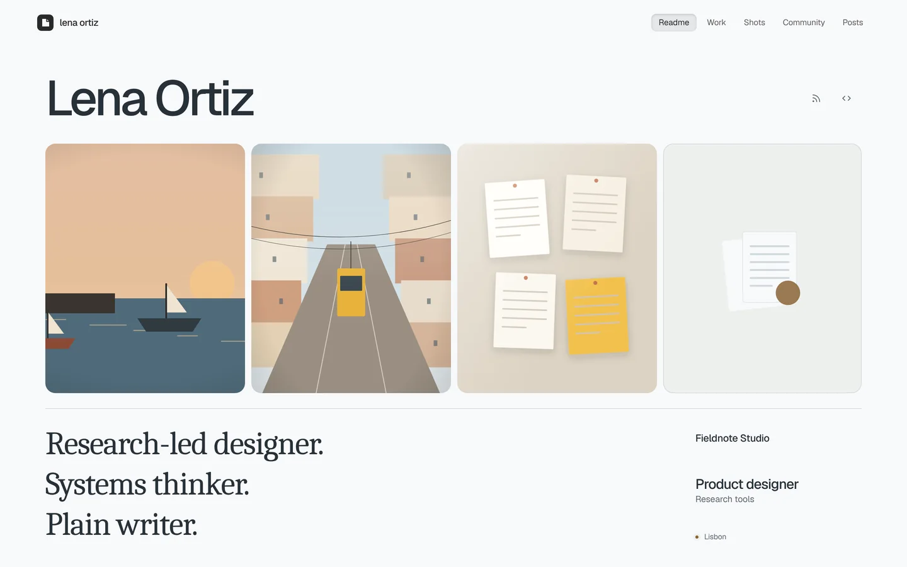
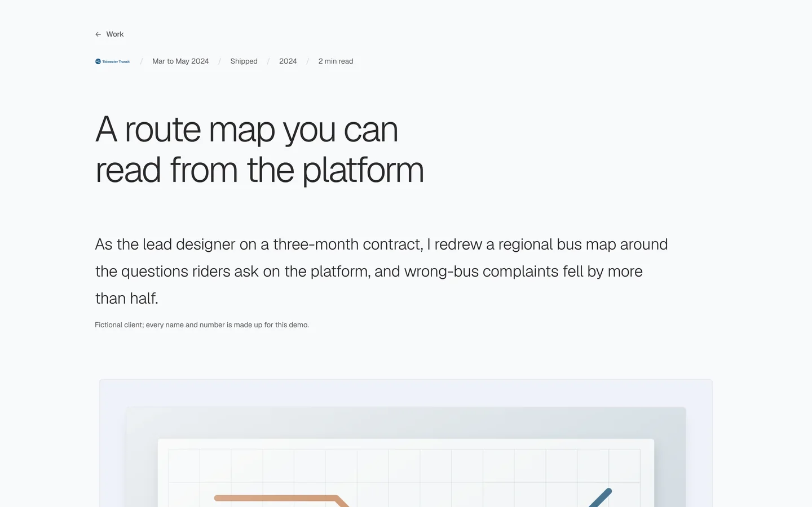
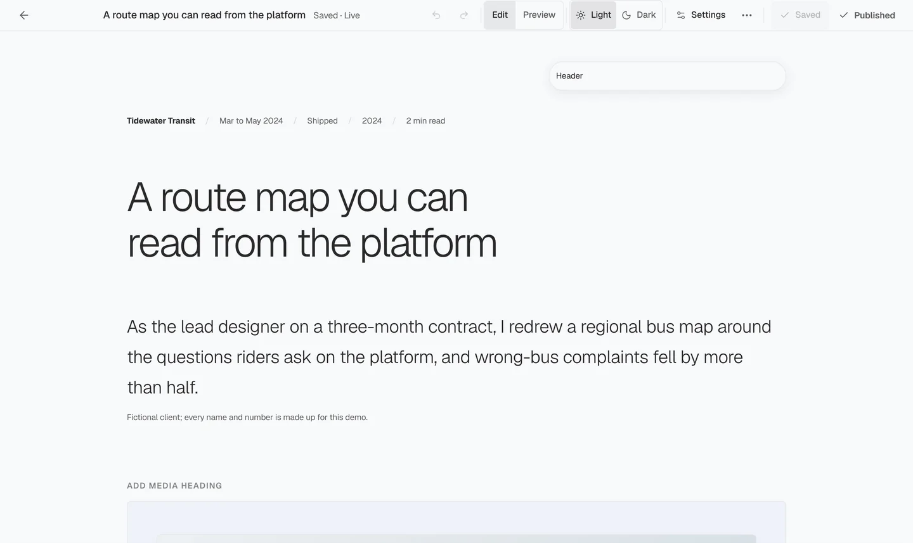
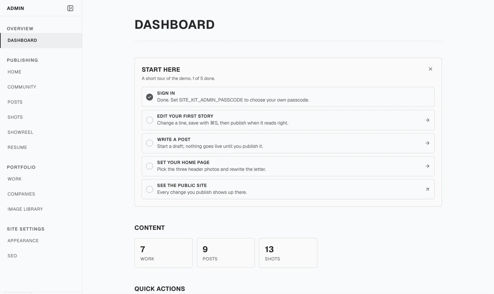
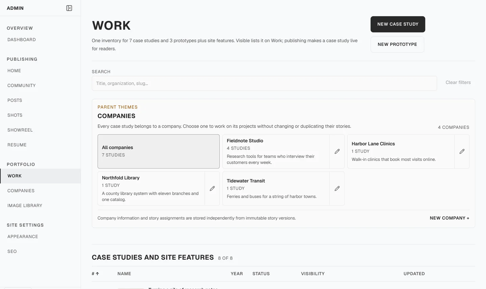
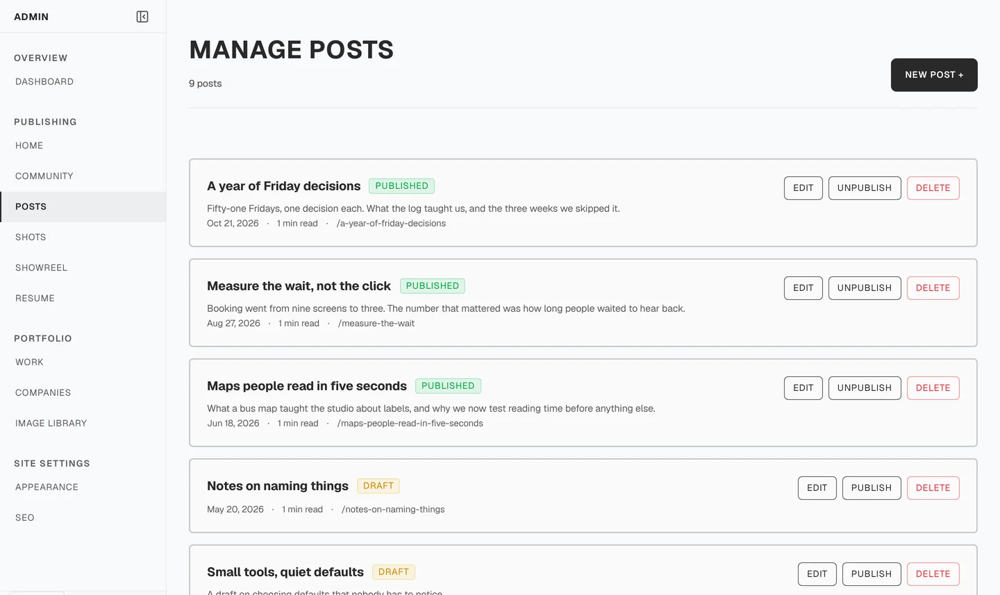
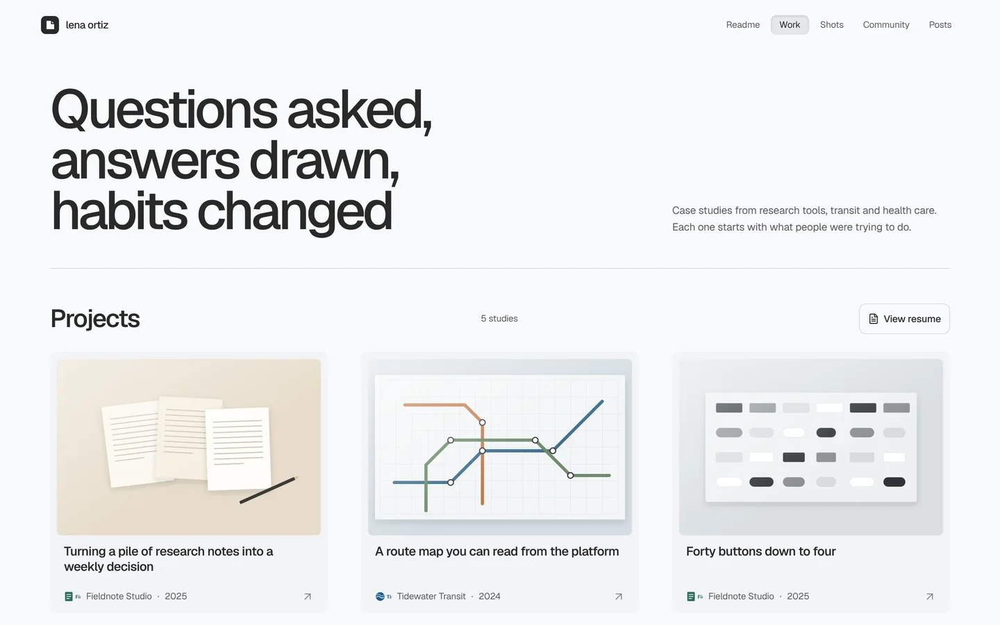
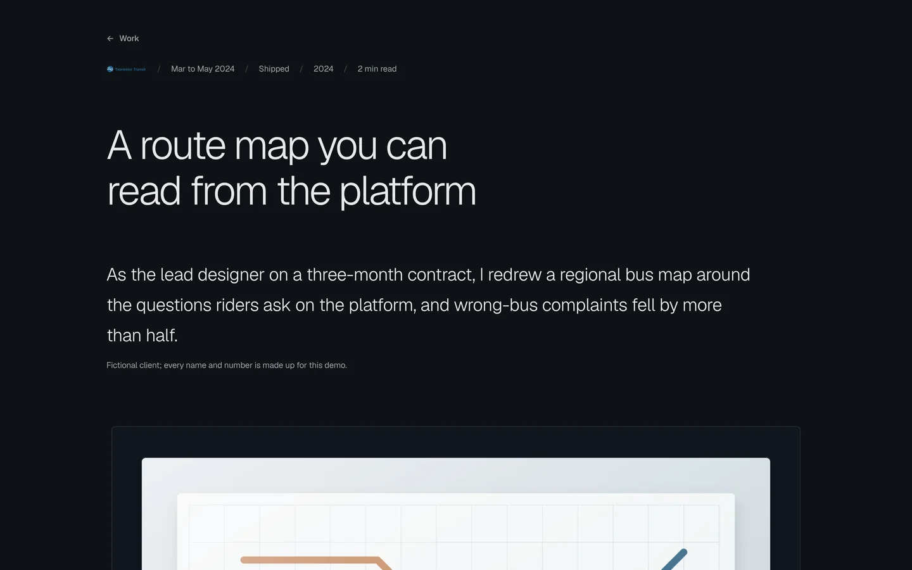
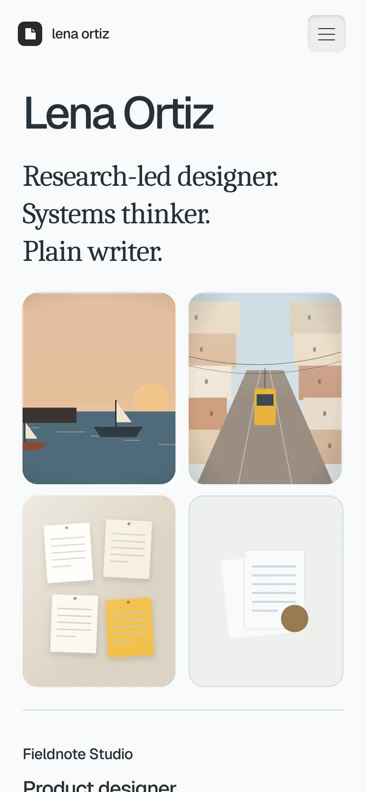

# site-kit

A portfolio site with its own CMS, ready to make yours: case studies edited in place on the real page, posts, a home page, a resume, and an admin for all of it. MIT-licensed, with no history from the site it came from.

> **New to code? Start with [GUIDE.md](GUIDE.md).** It walks a designer through getting a copy, running it, writing case studies and posts, choosing a database and putting the site online, one step at a time.

```sh
pnpm install && pnpm dev   # http://localhost:3000, admin at /admin (passcode `studio`)
```

Everything in the screenshots below is made up for the demo: Lena Ortiz and her clients don't exist.

<p align="center"></p>

| | |
| --- | --- |
|  |  |
| A case study, as readers see it | The same page in the editor: you write on the real layout |
|  |  |
| The dashboard, with a short tour to start | Work: every case study, grouped by company |
|  |  |
| Posts, saved as drafts until you publish | The public Work page |
|  |  |
| Dark mode follows the reader's system | On a phone |

## The story CMS

Long-form stories with chapters and rich blocks, edited in place on the real page, saved as append-only versions and published by pointer. Storage, media and sign-in sit behind adapters, so it runs on Postgres or in memory, keeps uploads on S3-compatible storage or local disk, and mounts in any framework that speaks web `Request` and `Response`.

| Package | What it does | Depends on |
| --- | --- | --- |
| [`@rcweston/story-core`](packages/story-core) | The content model, validation, publish readiness, renames and the contract every other part implements. Pure TypeScript. | nothing |
| [`@rcweston/story-server`](packages/story-server) | Request handlers plus adapters: memory and Postgres stores with explicit migrations, memory, local-disk and S3 media, a passcode sign-in. | story-core; `pg` and `aws4fetch` only if you use them |
| [`@rcweston/story-react`](packages/story-react) | The reader: the story page and every part of it, themed with `--story-*` tokens, custom blocks from your own registry. | React, Lucide |
| [`@rcweston/story-editor`](packages/story-editor) | The in-place editor: block tools and continuous writing over the reader's own components, talking to any backend through one transport. | React, Tiptap, Radix UI, save-kit |
| [`@rcweston/site-data`](packages/site-data) | The site's own settings as modules (page visibility, Work order, story placement, the image library), each with memory and Postgres stores, numbered migrations, handlers and public reads. | story-core, story-server; `pg` only if you use it |
| [`@rcweston/site-admin`](packages/site-admin) | The admin around the stories: a passcode-gated shell and fourteen screens (dashboard, Work, companies, projects, home, posts, community, shots, showreel, resume, image library, SEO, appearance and site resources), plus the review of a published version's changes. Modules add their own screens and sidebar items. | React, Tailwind v4, Radix UI, save-kit, site-data, story-editor |

[`apps/demo`](apps/demo) is a whole portfolio site on it, with made-up stories. It keeps its data in an embedded Postgres under `.data/` with no setup, and in any Postgres and S3-compatible bucket when you set `SITE_KIT_DATABASE_URL` and the `SITE_KIT_S3_*` variables (see [`apps/demo/env.example`](apps/demo/env.example)):

```sh
pnpm install && pnpm dev   # builds the packages, then runs the demo
pnpm db:migrate            # apply migrations yourself, when SITE_KIT_AUTO_MIGRATE=false
```

## Small packages

| Package | What it does | Depends on |
| --- | --- | --- |
| [`@rcweston/credits`](packages/credits) | Credits as data, checked in CI: the build fails when a dependency isn't credited. | nothing |
| [`@rcweston/save-kit`](packages/save-kit) | The save layer for React editing screens: failures in plain words, delete with Undo, kept edits, a leave guard, ⌘S, and signing back in over the page. | React |
| [`@rcweston/xray`](packages/xray) | An on-page inspector for spacing, type, tokens and accessibility, measured on the live page against your own rhythm. | React, Lucide |

## Working on it

```sh
pnpm install
pnpm check   # scrub, typecheck, tests, build, credits: what CI runs
```

Everything runs locally. Nothing here deploys anywhere.

## How this repo stays clean

This repo was built fresh, from an allowlist, with no history from the site it came from. Two checks keep it that way:

- **The scrub check** (`scripts/scrub.mjs`) runs first in CI and fails closed. It refuses private folders, font files, media, database dumps, env files and agent notes; common secret shapes; hosting variable names and storage hostnames; and a list of names that must never appear, which is stored as salted hashes so the list itself names nothing. `scripts/scrub.test.mjs` plants each kind of leak and proves it fails.
- **The credits check** runs the repo's own `@rcweston/credits` against `credits.config.mjs`. A new dependency anywhere in the workspace fails CI until it's credited.

## Credits

See [`credits.config.mjs`](credits.config.mjs). Designed and engineered by Charlie Weston, pair-programming with Claude Code.

## Licence

MIT. See [LICENSE](LICENSE).
